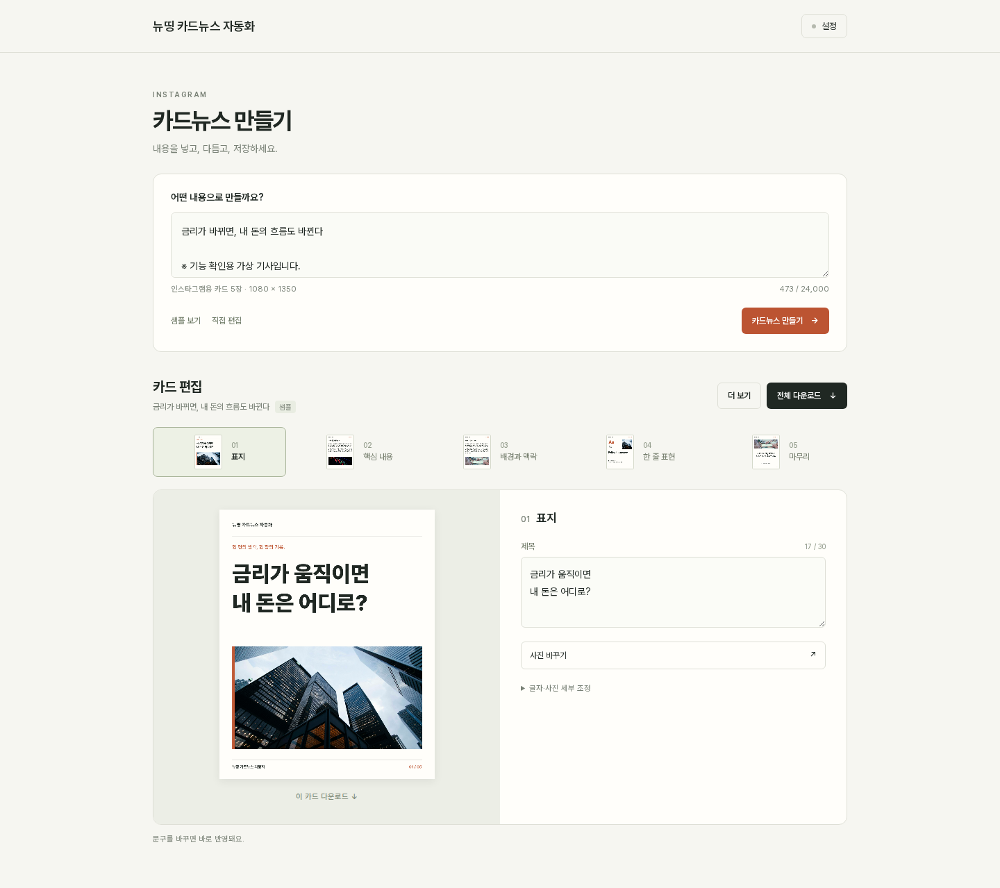

# 검증 기록

## 비용 0원 배포 구조와 Figma 자동 전송 — 2026-10-20

- **자동 테스트 41개 통과:** 기존 API 17개, Figma 장면·레이어·플러그인 10개, 연결·전송·저장소 12개, 무료 호스팅 경로 2개. 노드 검증, 사진 크롭·그라데이션, 폰트 대체, 실패 시 새 노드 정리, 요청 ID 중복 방지, 계정별 연결 저장, 대상 페이지 변경 방지를 확인했습니다.
- 발신·수신 권한 분리, 연결 코드 만료, 전송 조각 업로드·수신·완료 삭제, 취소·연결 해제, 여러 파일의 수신 충돌, 익명 연결 요청 제한을 확인했습니다. SQLite 재연결·원자적 갱신과 D1의 비교 후 갱신·TTL·만료 정리를 실제 내장 DB로 검증했습니다. D1 무료 한도 오류는 모의 한도 응답으로 검증했습니다. Redis 어댑터와 연결 환경 변수는 제거했습니다.
- Chromium에서 실제 웹앱·로컬 API·플러그인 UI·플러그인 본체를 연결했습니다. Figma API만 모의 객체로 대체한 호스트를 사용했습니다. 10자리 코드 등록 → 샘플 생성 → **Figma에서 제작** → 1080×1350 카드 5장 생성 → 웹앱 **5장 제작 완료** 표시를 확인했습니다. 카드마다 사진 1개와 편집 가능한 텍스트 4~5개가 생성됐습니다. YouTube도 1920×1080 프레임 1개와 **1장 제작 완료** 표시를 확인했습니다. 결과 파일 선택은 없습니다.
- 플러그인의 격리된 iframe에서 Web Crypto의 `subtle`이 없는 환경도 재현했습니다. SHA-256 대체 경로는 Unicode·패딩 경계·4.4MB 데이터에서 Node의 SHA-256과 일치합니다.
- 제작 완료 응답을 네트워크가 잃어버려도 다음 상태 조회에서 회복하고 같은 카드를 중복 생성하지 않는 테스트를 추가했습니다. 플러그인 재실행 중 수신 대상이 바뀌면 잘못된 대상으로 보내지 않고 오류를 표시하는 것도 브라우저에서 확인했습니다.
- 실제 키가 아닌 테스트 문자열로 GPT 키 등록 → 새로고침 복원 → 연결 해제 후 삭제를 확인했습니다. 유료 Generate 요청은 하지 않았습니다. 웹앱 새로고침과 플러그인 수신 화면 재실행 후 Figma 연결도 복원됐습니다.
- 390px 화면에서 사전 등록·전송·연결 대화상자가 페이지 가로 넘침 없이 표시됩니다.
- 기존 Canvas 렌더러와 현재 렌더러를 비교한 3개 카드뉴스 디자인·YouTube, 3개 배경의 **48개 출력이 PNG 픽셀까지 동일**합니다. 제목 강조·글자색·크기·CTA 정렬을 포함했습니다. 기존 PNG ZIP의 CRC·크기·캡션 포함도 확인했습니다.
- `npm test`, `npm run build`, `npm run validate`, `npm run build:cloudflare`, `git diff --check`가 통과했습니다. 웹앱에서 내려받은 최종 플러그인 ZIP의 CRC, 현재 소스·README 일치, `currentuser` 권한과 해당 스튜디오 출처 설정을 확인했습니다.
- Wrangler 4.151.2의 로컬 Cloudflare 런타임에서 `npm run db:local`, `npm run test:cloudflare`를 통과했습니다. 정적 경로 4개·보안 헤더·서버 공용 GPT 키 미사용·실제 D1 계정 연결·분할 전송·읽기·완료·연결 삭제를 확인했습니다. 이 테스트는 localhost에만 실행됩니다.
- D1 통합 테스트에서 이모지의 UTF-16 쌍이 전송 경계에서 갈라지는 문제를 발견했습니다. 조각을 JSON으로 인코딩해 저장하도록 수정한 뒤 한글·이모지 26만 자 이상의 재조합 SHA-256이 일치했습니다. 로컬 예약 작업도 `ok`를 반환했습니다.
- Cloudflare 빌드의 Worker는 약 40KiB, gzip 약 12KiB이며 22개 정적 파일과 분리됩니다. `wrangler deploy --dry-run`에서 바인딩·번들 검증을 통과했습니다. 실제 브라우저에서 무료 배포용 정적 자산으로 샘플 카드 5장·PNG ZIP 버튼·Figma 제작 버튼을 확인했고 콘솔 오류가 없었습니다.
- 플러그인 대기 확인은 10초, 웹앱 대기는 30초로 줄였고 제작 중에는 빠르게 확인합니다. 한도·연결 오류가 반복되면 수신 확인 간격이 최대 5분까지 늘어납니다.
- **실제 Figma 데스크톱 설치·캔버스와 원격 Cloudflare 배포는 미검증**입니다. 실제 문서에서 폰트·크롭·그라데이션을 최종 확인해야 합니다. 현재 Wrangler는 Cloudflare 계정에 로그인되어 있지 않습니다. 유료 플랜 신청·원격 배포·Community 게시·실제 GPT 호출은 하지 않았습니다. 비용 0원 운영에는 Workers Free 계정과 D1 연결이 필요하며 무료 한도를 넘으면 기능이 제한됩니다.

직접 검증: [플러그인 설치·계정 연결 안내](../figma-plugin/README.md)를 따라 연결하고 웹앱에서 샘플을 전송합니다. 프레임 5장, 편집 가능한 한글 텍스트·사진, 완료 표시, 실행 취소, 재전송, 다른 페이지 전환 시 대상 표시를 확인하세요. 플러그인을 다시 실행했을 때 첫 연결이 살아 있으면 최대 약 45초 뒤 인계됩니다.

---

검증일: **2026-10-19**. GitHub 비공개 저장소에 현재 프로젝트를 정리하면서 실행한 결과입니다.

## 환경과 범위

- Node.js `v24.14.1`, Linux / Bash, Chromium 기반 브라우저
- 외부 npm 패키지 설치 없이 프로젝트의 기본 명령 실행
- 로컬 확인 주소: `http://localhost:4187/generate` — 기본 포트 대신 `AXSTUDIO_PORT=4187` 사용
- 실제 OpenAI API 요청, 유료 생성, 신규 원격 배포는 실행하지 않음

## 자동 검증

| 명령 | 결과 | 확인 범위 |
| --- | --- | --- |
| `npm test` | 17개 통과, 실패 0개 | 기사 추출·URL 검사·생성 요청·응답·오류·이미지 제한 |
| `npm run build` | 통과 | 서버와 정적 자산을 포함한 Worker, Sites용 `dist/` 생성 |
| `npm run validate` | 통과 | 빌드 결과를 ESM으로 읽고 `default.fetch` 및 manifest 확인 |
| `npm run build:vercel` | 통과 | Vercel용 정적 파일 생성 |
| `git diff --check` | 통과 | 변경 파일의 공백 오류 검사 |

테스트의 외부 요청은 모의 `fetch`로 대체합니다. 주요 사례는 다음과 같습니다.

- 사설·특수 주소, 자격 증명 포함 URL, 사설 주소로 향하는 리다이렉트 차단
- 본문 대신 기사 검색·로그인 영역을 선택하지 않도록 본문 표시자 우선 처리
- 중첩된 `article`·`div` 안의 문단과 사진 보존, CRLF 공백 정리
- 너무 짧은 기사, 제한을 넘는 HTML 응답 처리
- API 키 없이 모델을 호출하지 않는지 확인, 개인 키의 서버 키보다 높은 우선순위
- 공급자 URL, `store: false`, strict JSON Schema 및 지시문·기사 입력 분리
- 잘못된 키·권한·결제 한도·속도 제한·모델 접근 오류의 구분
- 모델 거절·불완전한 출력·잘못된 JSON 콘텐츠 거부
- SVG 이미지 거부, Vercel 프록시의 4,000,000 bytes 제한

## 브라우저 확인

| 동작 | 확인 결과 |
| --- | --- |
| 초기 화면 열기 | 입력·채널·편집기 표시, 생성 전 다운로드 비활성화 |
| 샘플 불러오기 | 가상 기사 표시, 카드 5개와 문구·사진 렌더링 |
| 카드 크기 | 편집 카드 Canvas 5개가 각각 1080×1350 |
| PNG 생성 | 실제 Canvas 결과를 파일로 저장하고 PNG 헤더와 1080×1350 크기 확인 |
| ZIP 버튼 | 생성 완료 메시지와 버튼 재활성화 확인. 다운로드된 ZIP의 압축 해제·CRC 검증은 미실행 |
| 자동 저장 | localStorage에 콘텐츠 저장, 저장 객체에 `apiKey` 필드 없음 |
| 새로고침 | 기사 제목과 콘텐츠 복원, 다운로드 활성 상태 유지 |
| YouTube 모드 | 표시 카드 1개, 첫 Canvas 1920×1080 |
| 블로그 모드 | `/blog` 전환, 샘플 초안 707자 표시, 텍스트 다운로드 활성화 |
| 콘솔 | 위 확인 과정에서 콘솔 오류 없음 |

아래 화면은 API 키 없이 샘플 콘텐츠를 불러온 로컬 실행 결과입니다.



## 업로드 파일 점검

- 현재 소스와 기존 Git 이력의 텍스트를 대상으로 자격 증명 패턴을 점검했습니다.
- 탐지된 인증 URL은 테스트용 `user:pass@example.com`입니다. 실제 키로 판정된 값은 없었습니다.
- 환경 파일명, localhost 실행 예시, 이미지 ID·테스트용 IP 숫자, 과거 번들에 포함된 이미지·폰트 Base64에서 발생한 패턴 탐지를 구분했습니다.
- `.env.local` 등 개인 환경 파일, `.vercel/`, `.gstack/`, 빌드 결과물은 업로드 대상에서 제외합니다.
- `.env.example`에는 실제 API 키가 없습니다. 사진·폰트와 폰트 라이선스는 소스와 함께 보관합니다.
- 기존 Git 이력은 유지합니다. 과거 커밋의 생성 번들은 남아 있으며, 최신 소스 트리에서는 빌드로 재생성합니다.

이 점검은 전체 보안 감사나 취약점 부재의 보증이 아닙니다. 현재 구현의 접근 통제와 URL 필터 범위는 [README의 운영 조건](../README.md#현재-제한과-운영-조건)에 기록했습니다.

## 직접 다시 확인하기

```sh
npm test
npm run build
npm run validate
npm run build:vercel
npm run dev
```

브라우저에서 `/generate`를 열어 샘플을 불러온 다음 문구·배경·사진을 수정하고 PNG·ZIP을 저장합니다. 새로고침 후 내용이 복원되는지 확인하고, YouTube·블로그·리서치 채널을 전환합니다.

실제 생성 검증이 필요하면 자신의 프로젝트 API 키를 입력한 뒤 공개 기사 또는 본문을 사용합니다. 이 단계에서는 실제 API 사용량과 비용이 발생합니다. 모델 계정 권한·생성 품질·기사 사이트별 수집 가능 여부 및 원격 배포는 별도로 확인해야 합니다.
